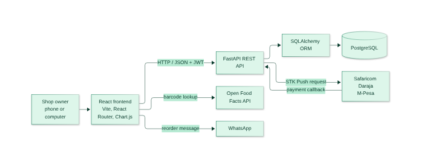
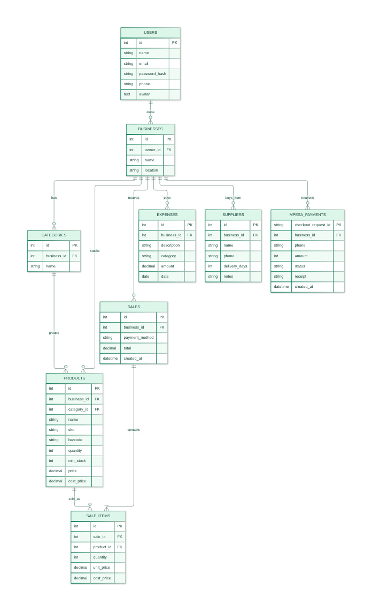
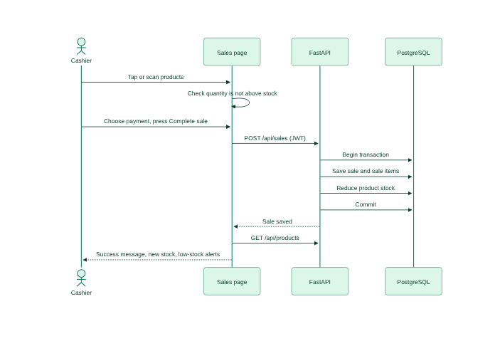
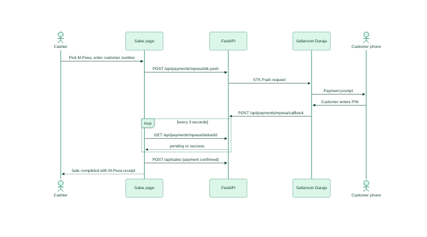
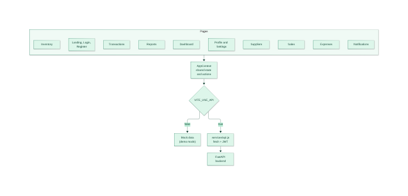

# DukaSmart architecture

Diagrams for the project report. The PNG images in `docs/diagrams/` can be pasted straight into Word. The `.mmd` files next to them are the Mermaid source: paste one into https://mermaid.live to edit it, or view it directly on GitHub.

## 1. System architecture
Client-server architecture from section 6 of the project document, with the extra services the frontend uses.

| Part | Role |
|---|---|
| React frontend | All screens, runs in the browser on a phone or computer |
| FastAPI REST API | Business rules, authentication (JWT), talks to the database |
| SQLAlchemy + PostgreSQL | Stores users, products, sales, expenses, suppliers and payments |
| Safaricom Daraja | Sends the M-Pesa payment prompt and reports the result |
| Open Food Facts | Free product database used to fill in details from a barcode |
| WhatsApp | The supplier reorder message opens as a WhatsApp link |

## 2. Database design (ERD)
The seven tables from section 7 of the project document, plus `SUPPLIERS` and `MPESA_PAYMENTS` for the extra features. Every business record belongs to one owner, so users only see their own data.

## 3. Recording a sale
Shows the rules "a sale reduces stock", "a sale cannot exceed stock" and "use database transactions".

## 4. M-Pesa payment prompt
The sale is only saved after the payment is confirmed.

## 5. How the frontend is organised
Pages never call the backend directly. They use `AppContext`, which either serves demo data or calls the API depending on `VITE_USE_API`.

## Technology summary
| Layer | Technology |
|---|---|
| Frontend | React 18, Vite, React Router, Chart.js (react-chartjs-2), plain CSS with light/dark variables |
| Backend | Python, FastAPI, SQLAlchemy, JWT authentication |
| Database | PostgreSQL |
| External services | Safaricom Daraja (M-Pesa Express), Open Food Facts |
| Tools | Git and GitHub, Postman (API tests), Vitest (frontend tests), Jira |
