# DukaSmart user guide

For shop owners and shop assistants. DukaSmart helps you track stock, record sales and expenses, and see your profit, on your phone or computer.

## 1. Getting started
1. Open DukaSmart and tap **Start free**.
2. Enter your name, shop name, email and a password of at least 6 characters, then tap **Create account**.
3. Next time, use **Log in** with the same email and password. To leave, tap **Log out**.

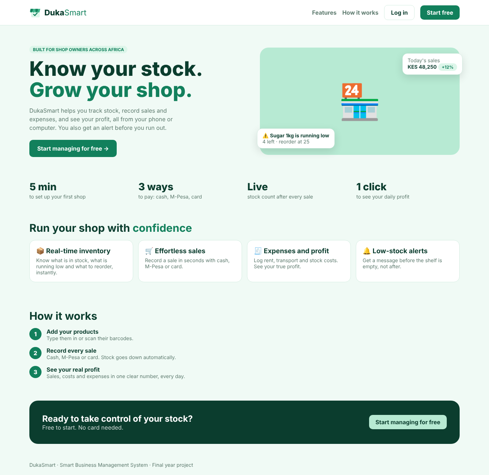

## 2. The dashboard
The first screen after logging in shows today at a glance: sales, expenses, profit and the number of products that need reordering. The chart compares your sales and expenses for the last seven days. Tap the DukaSmart logo at any time to come back here.

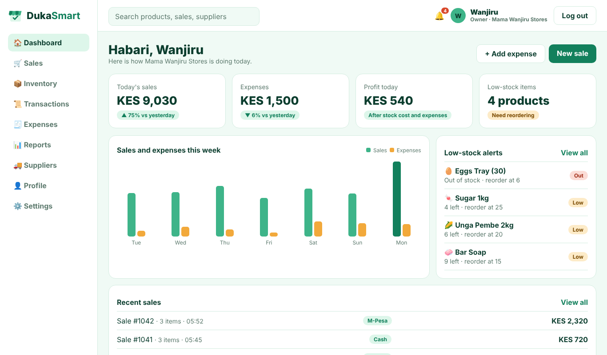

## 3. Adding your products
1. Open **Inventory** and tap **+ Add product**.
2. If the product has a barcode, type it in (or tap the camera button to scan it) and tap **Look up**. The name and category fill in by themselves.
3. Enter the selling price, the cost price (what you paid), how many you have, and **Reorder at**: the stock level where you want a warning.
4. Tap **Save product**.

To change a product, tap **Edit** on its row. To remove it, tap **Delete**.

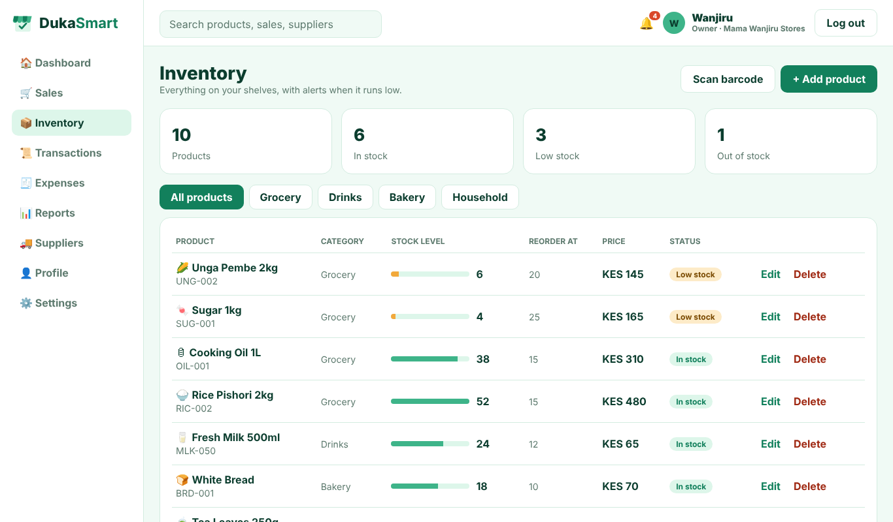

## 4. Recording a sale
1. Open **Sales**. Tap each product the customer is buying, or scan its barcode. Use + and − to change quantities. You cannot sell more than you have in stock.
2. Choose how the customer pays: **Cash**, **M-Pesa** or **Card**.
3. Tap the green button. Stock goes down automatically.

### Paying with M-Pesa
1. With M-Pesa selected, tap **Request M-Pesa payment**.
2. Enter the customer's phone number and tap **Send payment prompt**.
3. The customer gets a prompt on their phone and enters their M-Pesa PIN. The screen waits up to 90 seconds.
4. When the payment goes through, the sale is saved with the M-Pesa receipt number. If it fails, you see the reason and can try again.

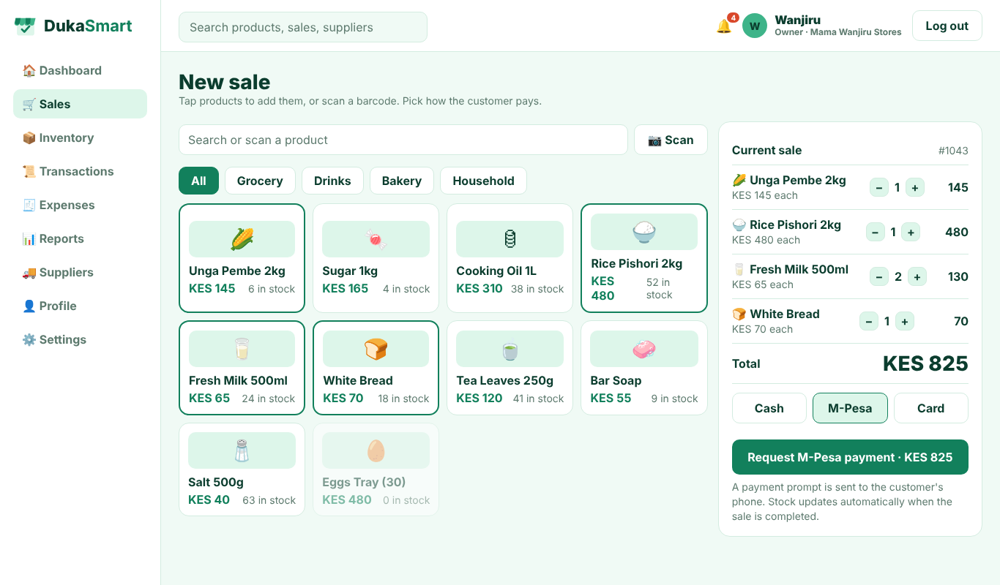
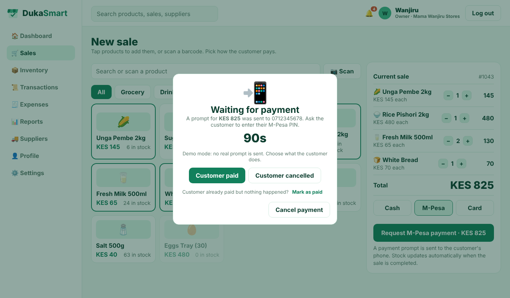

## 5. Low-stock alerts and notifications
The bell at the top shows how many new notifications you have. Tap it to see:
- products that are **running low** or **out of stock**
- every new **sale** that was recorded

Tap **Mark as read** on one, or **Mark all as read**. Tap **Reorder** to go to Suppliers.

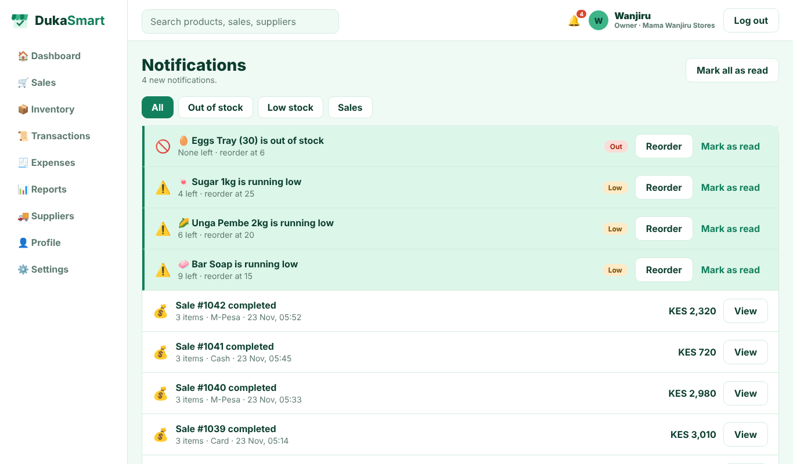

## 6. Reordering from suppliers
1. Open **Suppliers** and add the people you buy from, with their phone number.
2. Under **Reorder low-stock items**, untick anything you do not need and change the quantities.
3. Choose the supplier and tap **Send list on WhatsApp**. WhatsApp opens with the message already written. Just press send.

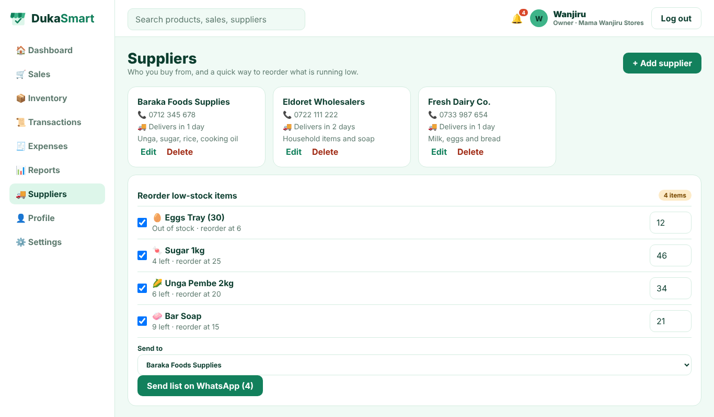

## 7. Expenses
Open **Expenses** and tap **+ Add expense** to record rent, transport, wages and other costs. You can **Edit** or **Delete** any entry. Your profit on the dashboard already takes these away.

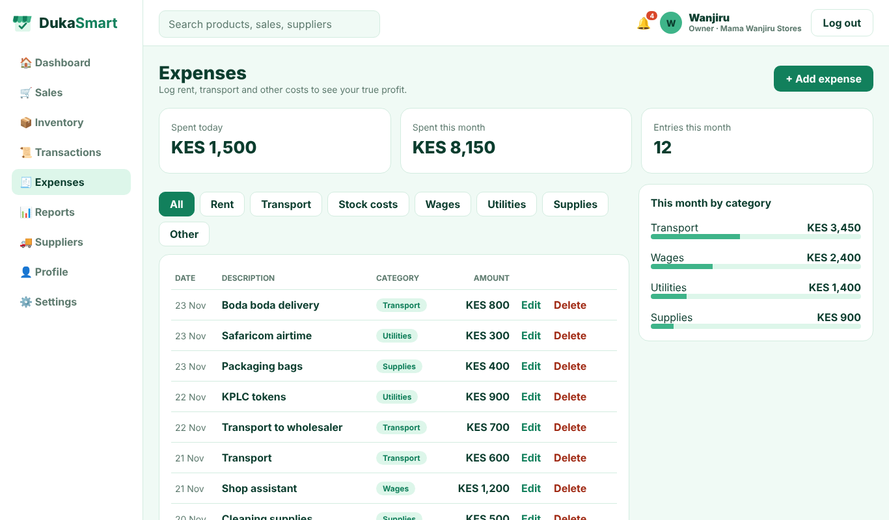

## 8. Transactions and reports
- **Transactions** lists every sale. Filter by payment method, search by sale number, and tap a row to see what was sold.
- **Reports** shows revenue, gross profit, expenses and net profit for the last 7 or 30 days, with charts and your top-selling products.

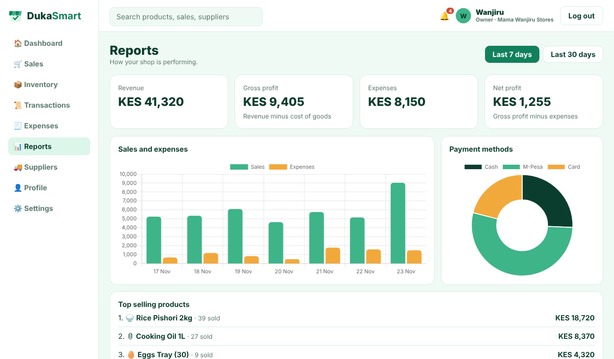

## 9. Search
The search box at the top finds products, sales, suppliers and pages. Type a few letters, then tap a result to go there.

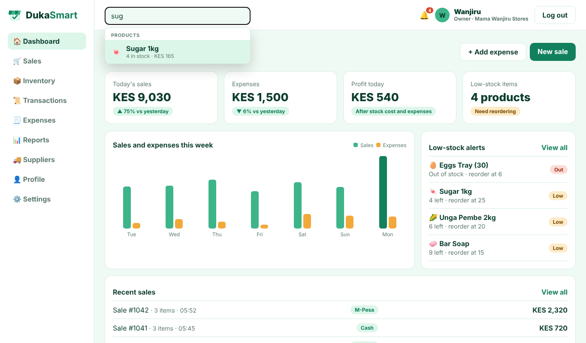

## 10. Your profile and settings
- **Profile:** add a photo, change your name, shop name, phone and location, or change your password.
- **Settings:** choose **Light** or **Dark** appearance, and log out.

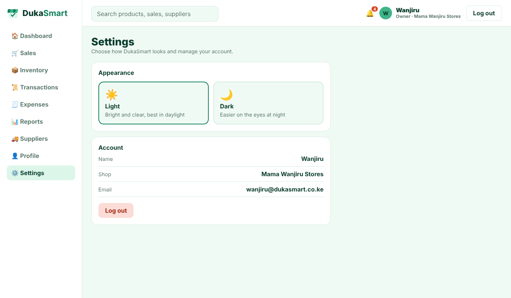

## 11. Using it on a phone
DukaSmart works on a phone browser. The menu becomes a row you can swipe sideways.

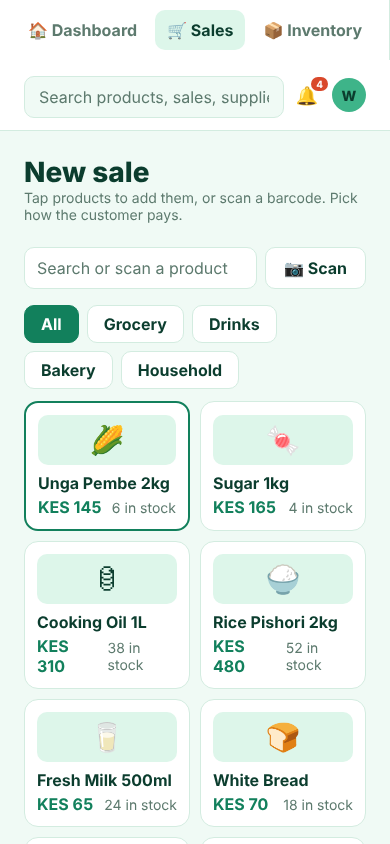

## Tips and common questions
| Question | Answer |
|---|---|
| Why can't I add more of a product to the sale? | You have reached the stock you have. Add stock in Inventory first. |
| A product says "Low" | Your stock is at or below its **Reorder at** number. |
| The M-Pesa prompt did not arrive | Check the number, ask the customer to check their network, then tap **Try again**. |
| Camera scanning does not open | Allow camera access in the browser. It works only on a secure (https) page. |
| How is profit worked out? | Sales minus what the goods cost you, minus your expenses. |
